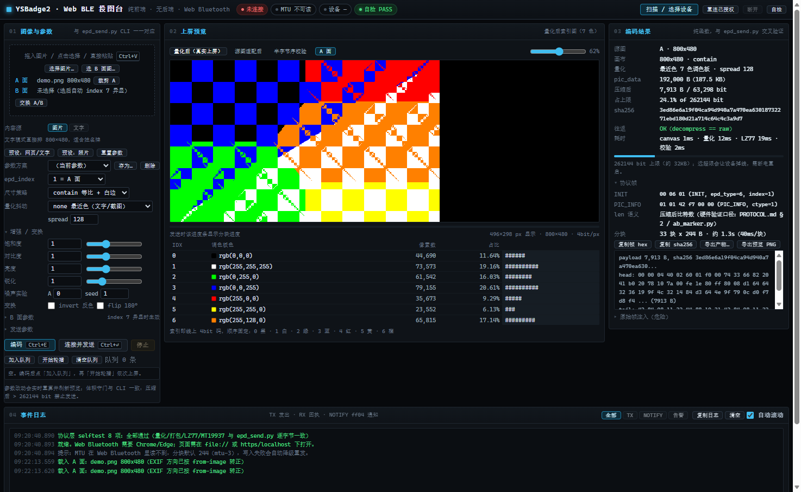
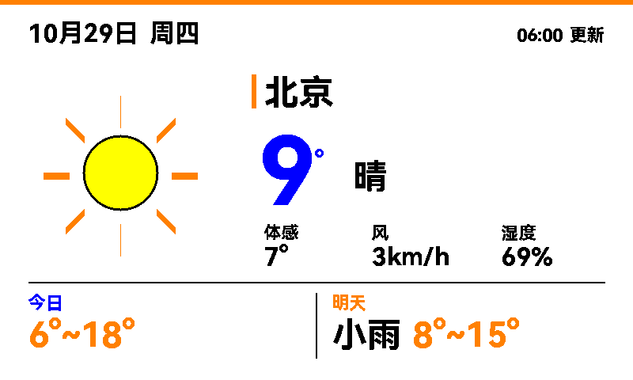

# 墨水屏投图工具 — 总结

## 设备
- 名称：YSBadge2
- BLE MAC：EE:96:BB:1E:05:28
- 双面 800x480 七色电子墨水屏（每像素 4bit）

## 已实现
- 纯 Python（bleak）发送器 epd_send.py，可从 PC 直接向任一面/双面投图
- 完整复刻 APK 的图片编码与 LZ77 压缩；压缩→解压自检与原数据逐字节一致

## BLE 协议（实测确认）
服务 ff01；write_pic ff02（write-without-response）；write_cmd ff03；notify ff04。

命令帧（BLE 路径无 CRC）：
    INIT:      [0x00, epd_type=6, epd_index]
    PIC_INFO:  [0x01, compress_type=1, len0..len3]   len 小端 = 压缩后比特数
    PIC_DATA:  写 ff02 的原始字节流，按 MTU-3 分块，约 40ms/块
    UPDATE:    [0x03,0x00]（可选；NFC 路径发，BLE 官方 App 不发）

epd_index：1=屏A，2=屏B，3=A&B同显，7=A&B异显（拼接两图）。

## 关键约束（实测）
1. **压缩模式**（compress_type=1）下 payload 必须 <= 262144 bit（约 32KB）。实测超出不只是不刷新：272000 bit / 34000B 会在传输中途掉线且不再广播，必须断电重启（docs/PROTOCOL.md §9）。
2. 因此压缩模式下不能对**照片**开抖动：FS 约 155KB、Bayer 约 39-45KB 均超限。官方 App 也从不抖动（dither_enable 硬编码 false）。
   注意抖动是否超限取决于内容：日历截图开抖动仅 103719 bit（12.7KB），仍在限内（docs/IMAGE_PROCESSING.md §7）。
3. **未压缩模式**（compress_type=0，192000B）本机实测**不可用**：能收完但不刷新，且常把 GATT 卡死、需断电重启；7 组对照见 docs/LESSONS.md §1。`--no-compress` 仅作实验开关保留。
4. 双面更新：index 1 只刷 A，index 2 只刷 B。连续快速发送可能被设备"正在刷新"吞掉，两次发送建议间隔约 30s。
   数据发完约 38s 后 ff04 会上报 `00 00`（刷新完成），保持连接即可拿到确定信号，见 docs/PROTOCOL.md §8.0。
5. index 7（双面异显）受 32KB 限制，两张较大的图合并不现实；仅当两图都很简单时才可能。走未压缩模式时为 384000B、约 63s，不受 32KB 限制。
   **2026-10-21 实机确认**：压缩模式下的 index 7 可用——A 面红条大字 A + B 面蓝条大字 B
   两张 800x480 图合并后 7883 B / 63063 bit（占上限 24.1%），两面分别正确显示，ff04 回 `02 00 00`。

## 工具用法（epd_send.py）
    python epd_send.py --image x.jpg --index 2
常用参数：
- --index 1|2|3：A / B / 双面同显
- 适配：默认等比(contain)；--fill 铺满并裁切；--stretch 拉伸铺满（可变形）
- 画质：--sat 饱和度  --contrast 对比  --bright 亮度  --sharp 锐化
- 抖动量化走 PIL C 实现（--dither 约 0.4s）；LZ77 用 2 字节前缀索引（照片约 0.7s）；整条编码链路约 1.1s
- --image2 / --dither2 / --invert2 / --flip2：配合 index 7 双图
- --no-compress：compress_type=0 未压缩发送（len 填 192000 字节数，不受 32KB 限制，约 31.5s/面）
- --offline：只编码并打印压缩体积/负载，不发送
- --noise / --seed：给图加噪（用于体积实验）

发送前会自动检查体积：压缩后超过 262144 bit 直接拒绝发送（exit 2）并给出建议，不再白发 30 秒。
`--offline` 仍会打印体积并标注 `<== 超限`。

图片载入已处理两个常见坑：EXIF 方向（手机竖拍自动转正）、透明底铺白（PNG 透明区不再变黑）。

示例：
    python epd_send.py --image "C:/path/a.jpg" --index 2 --fill --sharp 1.5
    python epd_send.py --image "C:/path/a.jpg" --index 1 --sat 1.6 --contrast 1.25 --fill

## 网页版工具（web/，纯前端、无后端）

    web/index.html        双击用 Chrome/Edge 打开即可（file:// 属于安全上下文，可用 Web Bluetooth）
    web/ysbadge-core.js   协议层纯函数模块：量化/4bit 打包/LZ77/MT19937，页面与 Node 校验共用

BLE 走浏览器 **Web Bluetooth**，不需要 Python、不需要起服务：

- 点「扫描/选择设备」弹出系统选择框（按名字前缀 YSBadge 或 ff01 服务过滤）；
  首次配对后「重连已授权」可直连，不必再走弹窗——用来应对桌牌唤醒后广播窗口短的问题。
- 每个 CLI 参数都有对应控件，另加这些 CLI 没有的操作：
  分块大小/块间隔实时可调、写入失败自动降级分块重发（244→180→128→64→23）、
  PIC_INFO 的 len 语义切换（字节数 ↔ 压缩后比特数）、ff03 带响应写开关、UPDATE 开关、
  原始 hex 帧直接注入 ff03/ff02（需勾选风险确认）、
  一键导出 payload(.bin) + frames.txt 与 CLI --offline 产物对照、
  A/B 面人工裁剪（拖拽画新框/框内移动/四角缩放/比例锁定 自由·5:3·1:1·4:3，在 fit 之前生效）。
- 内容源双模式：**图片**（拖入/点选/粘贴）与**文字**（多行直接排 800×480：字体/字号/字重/7 色/对齐/行距/黑白底，姓名牌场景不用先做图）；
  index 7 异显时可切 A/B 面预览，也可一键交换 A/B。
- 发送队列：编码后「加入队列」→「开始轮播」，多条依次上屏，**每条之间等 ff04 00 00 刷新完成回执**（约 38s，60s 超时按经验值继续）；单发后也有回执倒计时。
- 参数方案：整套参数命名存/取/删（localStorage，不可用时退化为本次会话内存）。
- 展示：量化后**真实上屏预览**（渲染的就是将写入 ff02 的 4bit 数据，可切换"由线上数据解码渲染"）、
  7 色分布直方图、体积/占上限百分比/sha256、LZ77 往返校验、分阶段耗时、
  INIT/PIC_INFO 帧 hex 与分块预估、发送进度条（含剩余时间）、ff04 通知时间戳日志（可按 TX/NOTIFY/告警过滤，
  已知帧型带语义：02 00 00=已收 INFO / 00 02=等数据超时 / 00 00=刷新完成回执）。
- 交互：所有参数**实时联动**（改动即防抖 180ms 重算，预览/体积/帧同步刷新，顶部显示"编码中"）；
  预设按钮（网页/文字 = 关抖动 + 锐化 1.6；照片 = FS + fill，见 IMAGE_PROCESSING.md §2 的按内容选抖动）；
  快捷键 Ctrl+E 编码 / Ctrl+Enter 发送；帧 hex 与 sha256 一键复制；拖入（页面任意位置）/点选/ Ctrl+V 粘贴三种上图方式；
  发送中关闭页面会先弹警告；页面加载即跑协议层 selftest，结果在顶栏 pill；按 ? / F1 看快捷键与 ff04 帧型速查。
- index 7 异显时可切换 A/B 面预览；体积超限时有一键自救（关抖动重算）；帧注入栏可一键填入 INIT/PIC_INFO/UPDATE。
- 编码/发送进度同步到 document.title，方便切到别的标签页时瞄一眼。
- 体积守门与 CLI 一致：压缩后 > 262144 bit 拒绝发送。

与 epd_send.py 的差异（有意为之，均不影响协议正确性）：

| 环节 | 差异 |
| --- | --- |
| 缩放 / 增强 | 走浏览器 canvas，与 PIL LANCZOS / ImageEnhance **不逐字节一致**；喂 800×480 源图即可完全复现 |
| FS 抖动 | 手写标准误差扩散，噪声图案与 PIL 不同（语义一致，见 IMAGE_PROCESSING.md §3） |
| MTU | Web Bluetooth 读不到，分块大小手动指定 + 失败自动降级 |
| **协议层** | 量化(none/ordered/noise)、4bit 打包、LZ77、噪声 RNG 与 epd_send.py **逐字节一致**，由 _verify/check_web_core.py 交叉验证（25 个向量全过） |

实机发送路径（Web Bluetooth 写入时序）尚未在设备上验证；编码/压缩已逐字节验证。

> 2026-10-21 实机确认（曾用一次设备失联换来）：PIC_INFO 的 len 在 compress_type=1 时必须填
> **压缩后比特数**。网页版最初跟了 `epd_send.py` 的字节数口径，结果屏幕无变化且设备失联需断电重启；
> 改回比特数后（`_verify/send_probe.py` 实测）正常刷新。`epd_send.py` 与网页版现已统一为比特数。

浏览器侧已验证（2026-10-21，headless Edge 155 + CDP）：页面加载零异常零 console.error，
drop 一张 800x480 图跑通完整管线（192000 B → 7913 B / 63298 bit，往返 OK，
PIC_INFO `01 01 e9 1e 00 00`，33 块 x 244 B），自检按钮 8 项全过。复现：

    msedge --headless=new --remote-debugging-port=9333 --user-data-dir=<临时目录> \
           file:///<仓库路径>/web/index.html &
    node _verify/browser_check.js 9333

2026-10-23 两轮交互/性能优化 + 一轮功能扩充后复跑仍全过（另跑 _verify/check_web_page.py 的 DOM+BLE 冒烟）：
新增启动自检 pill、日志过滤、导出产物（payload.bin/frames.txt/预览 PNG）、整窗拖放、发送中关页警告、窄屏单栏、
ff04 帧型语义与完成回执倒计时、A/B 面预览与交换、文字模式、发送队列轮播、参数方案、? 帮助 overlay；
A/B 设置友好化（index 7 自动展开 B 面区并写明继承关系、一键「跟 A 面一样」、可清除 B 面、预览 B 面有指示）；
unsharp 的盒式模糊由 3×Float64 全通道重写为 2×Float32 仅 RGB（约 37MB → 9MB 临时内存），预览渲染改 Uint32Array 整像素写入。
2026-10-23 晚追加人工裁剪（A/B 面独立，含比例锁定与激活标记）后复跑仍全过。

出图示例（与 ESP32 固件同一套 C++ 渲染器，`_verify/host/make_weather_example.py` 生成；北京 9° 晴，87,922 bit = 10,991 B，实机投到 A 面）：

## ESP32 定时投图（firmware/，每天 6:00）

一块 ESP32-C3（合宙 AirM2M CORE-ESP32C3）当 BLE 中央端：每天 6:00 自己取天气、画 800x480 七色图、
LZ77 压缩、BLE 投给胸牌，然后深睡到次日。PC 不用开机。

    firmware/weather_badge/            Arduino 固件（协议层 C++ 移植 + 排版 + BLE 中央端）
    firmware/weather_badge/config.h    改这里：WiFi/经纬度/城市/面别/时间/省电
    firmware/weather_badge/secrets.h   WiFi 凭据（gitignore，不随仓库走）
    tools/gen_font.py                  从系统 TTF 生成 1bpp 字模（换城市要补字后重跑）

    ./.toolchain/arduino-cli.exe compile --fqbn esp32:esp32:AirM2M_CORE_ESP32C3 \
        --board-options PartitionScheme=huge_app --output-dir firmware/weather_badge/build firmware/weather_badge

板型必须选 AirM2M_CORE_ESP32C3：用通用的 esp32c3 编出来的固件会无限重启并报 `partition table error`（原因与排查过程见 docs/ESP32_WEATHER.md §1）。
实测一张文字+图标图压缩后约 11KB（设备上限 32KB，5.8%），MTU 247 下 46~48 个包发完。

不想接 ESP32、或只想临时换一张图时，PC 端也能直接出图投图（同一套天气源，顶栏风格已对齐）：

    python tools/weather.py                       # 抓北京天气 -> 出图 -> 投到 B 面
    python tools/weather.py --index 1             # 投 A 面
    python tools/weather.py --sample --offline    # 无网/无设备：只出图 + 打印压缩体积

## 小字优化经验
- 等比缩小时小字易糊（源图大于 800x480 会被缩小）
- 源宽正好 800 时：等比=不缩但要裁切；拉伸=不裁但纵向压缩
- 锐化(--sharp 1.5~2.0)+对比可明显改善笔画；七色墨水屏对小字仍有物理极限

## 参考与致谢

协议结论的原始证据来自厂商 App（`reference/apk/base.apk`）的逆向分析；以下外部项目与资料在调研中被参考，
结论的证据分级（源码/他机/本机/待验）见 `docs/LESSONS.md` 与 `docs/REFERENCE_EPDIY.md`：

| 参考 | 用在了哪里 |
| --- | --- |
| eink-deskcard-demo（第三方 macOS 示例项目，未随仓库分发） | LESSONS.md 的全部对照实验：未压缩通道、PIC_INFO len 语义、健壮性设计 |
| [vroland/epdiy](https://github.com/vroland/epdiy)（ESP32 墨水屏驱动板） | REFERENCE_EPDIY.md §1：32KB 归属的架构佐证、波形/LUT 背景；其不支持七色 ACeP，是本项目的反面证据 |
| [tsl0922/EPD-nRF5](https://github.com/tsl0922/EPD-nRF5) 与 [epdiy.cn](https://epdiy.cn/)（nRF51822 蓝牙墨水屏日历） | REFERENCE_EPDIY.md §2：BLE 上传固件的流式架构、时间同步命令设计、广播窗口行为的互相印证 |
| [GxEPD2](https://github.com/ZinggJM/GxEPD2)（Arduino 墨水屏库） | ACeP 七色 canonical 色序对照；GDEY073D46 黄色偏色问题（IMAGE_PROCESSING.md §10） |
| [cale-idf](https://github.com/martinberlin/cale-idf) + CALE.es（ESP-IDF 七色驱动与在线渲染） | GDEY073D46 控制器 SPD1656 判定、32s 满刷/无局刷、照片抖动经验 |
| [Adafruit CircuitPython spd1656](https://circuitpython.readthedocs.io/projects/spd1656/) | ACeP 控制器家族背景 |
| [Good Display GDEY073D46](https://www.good-display.com/product/442.html) 与 [微雪 7.3inch e-Paper (F)](https://www.waveshare.com/wiki/7.3inch_e-Paper_HAT_(F)) | 屏体参数（HARDWARE.md §7）、刷新时间、工作温度 |
| [Pimoroni Inky Impression](https://shop.pimoroni.com/)（5.7 寸同族 ACeP） | 七色呈色特性旁证 |
| 天气数据：中国天气网 / 墨迹天气 / 华风爱科 / wttr.in | `_verify/gen_weather.py` 的数据来源（2026-10-23 三源印证） |
| [DMIF073CBW1](https://www.eink-display.com/product/90.html)（双面七色 NFC/BLE 公告牌） | 同品类整机形态参考 |

## 目录结构
    README.md                 本总结（入口）
    CODEBUDDY.md              给 AI 协作方的仓库指引
    LICENSE                   MIT
    epd_send.py               主发送工具（CLI）
    web/                      网页版投图台（纯前端 Web Bluetooth，无后端）
      index.html              页面（双击用 Chrome/Edge 打开）
      ysbadge-core.js         协议层纯函数模块，与 epd_send.py 逐字节一致
    firmware/                  ESP32 端固件（每天 6:00 自动投天气）
      weather_badge/           主 sketch + 协议/排版/字模/config.h
    docs/                     结论文档（协议/工艺/经验，改代码前先读）
      PROTOCOL.md             协议实测确认版（权威）
      IMAGE_PROCESSING.md     7 色出图工艺
      LESSONS.md              参考项目对照实验与待验清单
      REFERENCE_EPDIY.md       epdiy 等参考项目对照（他机/源码级）
      APK_FEATURES.md         APK 功能与实现分析
      HARDWARE.md             硬件识别与取固件流程
      ESP32_WEATHER.md        ESP32 定时投图：板型坑、内存账、调度、烧录命令
    tools/                    BLE 辅助脚本（scan_ble.py 扫描、gatt_dump.py 枚举、watch_ble.py 观察广播）
    reference/                参考材料
      apk/base.apk           官方 APK 原件（53M，不可再生）
      apk/ysbadge/           协议层反编译源码 8 个文件（docs 引用的原始证据）
      apk/README.md          再反编译方法与收录范围说明
    _verify/                  硬件实验脚本 + 自动化校验（check_web_core / check_web_page /
                            browser_check / send_probe；脚本用途见 _verify/INDEX.md）
    docs/images/              README 截图与硬件照片（web-tool / weather-example / hardware/）

## 未决 / 注意
- 32KB 上限为实测推断（成功 <= 32024B，失败 >= 39186B），未做精确二值标定。
- compress_type=0 未压缩通道**已关闭**：2026-10-21 本机 7 组对照实测不刷新且会卡死 GATT，
  不再是待验项（docs/LESSONS.md §1）。
- `_verify/check_fixes.py` 的 EXIF 断言不稳定：JPEG 有损压缩会在文字边缘翻转最近色判定，
  与 `epd_send.py` 的 EXIF 处理无关（转正本身正常），断言待改成结构检查。
